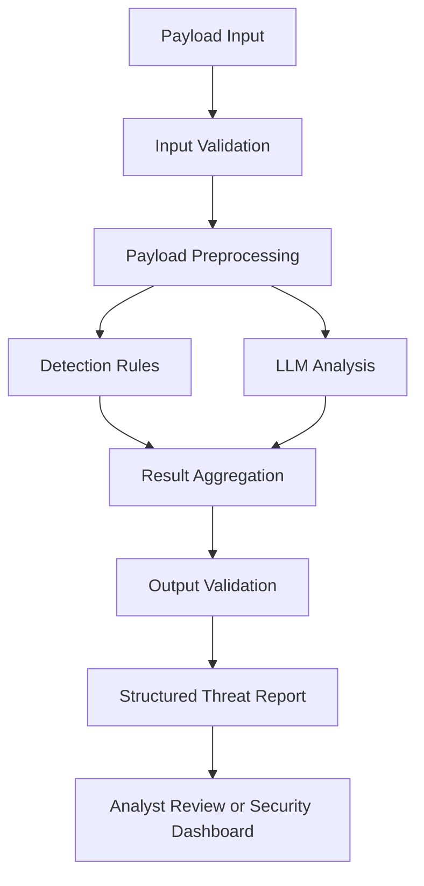

# 🛡️ Autonomous SOC LLM — Intelligent Payload Detection & Analysis

An LLM-powered cybersecurity project designed to analyze suspicious payloads, identify potential attack patterns, and generate security-focused explanations to support threat detection and investigation.

The project explores how Large Language Models (LLMs) can be applied to security analysis by interpreting potentially malicious inputs, recognizing attack indicators, and producing structured detection results that help security analysts understand potential threats.

Rather than relying exclusively on keyword matching or predefined signatures, the system aims to combine contextual language understanding with security-oriented validation to support more explainable payload analysis.

> **Project Focus:** LLM-based Payload Detection, Threat Analysis, AI Security, and Intelligent SOC Automation.

---

## 📌 Table of Contents

- [Overview](#-overview)
- [Problem Statement](#-problem-statement)
- [Project Objectives](#-project-objectives)
- [Key Features](#-key-features)
- [Supported Payload Categories](#-supported-payload-categories)
- [How It Works](#-how-it-works)
- [System Architecture](#-system-architecture)
- [Technology Stack](#-technology-stack)
- [Detection Methodology](#-detection-methodology)
- [Security Considerations](#-security-considerations)
- [Evaluation and Testing](#-evaluation-and-testing)
- [Getting Started](#-getting-started)
- [Example Analysis](#-example-analysis)
- [Limitations](#-limitations)
- [Future Improvements](#-future-improvements)
- [Project Goals](#-project-goals)
- [Disclaimer](#-disclaimer)

---

## 🔍 Overview

**Autonomous SOC LLM** is a cybersecurity research and development project that explores the application of Large Language Models to suspicious payload detection and security analysis.

In modern cybersecurity environments, applications and security systems receive large volumes of user inputs, HTTP requests, scripts, command strings, and other potentially malicious data. Identifying threats within these inputs can be challenging because attack payloads may be obfuscated, encoded, modified, or designed to exploit weaknesses in application logic.

Traditional detection mechanisms, including signature-based rules and pattern matching, are valuable but may struggle with unfamiliar payload variations or inputs whose malicious intent depends on context.

This project investigates how LLMs can help address these challenges by analyzing the structure, semantics, and potential intent of suspicious payloads.

The system is intended to support security workflows by providing:

- Payload classification and suspicious-pattern identification.
- Context-aware security analysis.
- Explanations of potential attack behavior.
- Structured detection results for downstream processing.
- A foundation for future integration with automated SOC workflows.

The long-term objective is to develop an AI-assisted security analysis component that can be integrated into a broader Security Operations Center (SOC) or Security Orchestration, Automation, and Response (SOAR) environment.

### Core Principle

**Use LLMs to understand suspicious inputs, deterministic security controls to validate decisions, and structured outputs to support security investigations.**

An LLM should assist detection and analysis rather than serve as the sole security enforcement mechanism.

---

## 🎯 Problem Statement

Cybersecurity systems frequently encounter payloads that may contain malicious commands, injection attempts, suspicious encoded content, or instructions intended to manipulate an AI-powered application.

Several challenges make reliable detection difficult:

1. **Payload Variation:** Attackers can modify payload syntax, encoding, and structure to evade simple pattern-based detection.
2. **Contextual Ambiguity:** The same input may be harmless in one context but dangerous when interpreted by a vulnerable application.
3. **Limited Explainability:** A detection rule may flag an input without providing enough context for an analyst to understand the underlying risk.
4. **Prompt Injection Risks:** LLM-integrated applications may receive untrusted instructions designed to manipulate model behavior or bypass application safeguards.
5. **Security Analysis Workload:** Manual inspection of suspicious inputs can consume time that security analysts could otherwise spend investigating incidents.

Autonomous SOC LLM explores whether LLM-assisted analysis can improve the interpretation and explainability of suspicious payloads while maintaining explicit validation and security boundaries.

---

## 🚀 Project Objectives

The project focuses on the following objectives:

- Develop an LLM-assisted approach for identifying potentially malicious payloads.
- Explore contextual analysis beyond simple keyword matching.
- Classify suspicious inputs into meaningful security categories.
- Generate structured findings and human-readable explanations.
- Reduce reliance on unconstrained model-generated decisions through validation and deterministic checks.
- Establish a foundation for future integration with SIEM, SOAR, and AI security monitoring systems.

---

## ✨ Key Features

The following capabilities represent the project's intended functionality. Actual implementation status depends on the current codebase.

### 1. LLM-Based Payload Analysis

Analyze input payloads using an LLM to identify suspicious structures, potentially malicious intent, and relevant security indicators.

### 2. Threat Classification

Organize analysis results into security categories such as benign, suspicious, or potentially malicious, with an option to return an uncertain result when the available evidence is insufficient.

### 3. Context-Aware Detection

Examine the meaning and structure of an input rather than depending exclusively on individual keywords or fixed signatures.

### 4. Explainable Security Findings

Produce concise explanations describing which characteristics triggered suspicion and why the payload may represent a security risk.

### 5. Structured Analysis Results

Represent findings in a consistent format suitable for application interfaces, logging, testing, and potential downstream security automation.

### 6. Security-Oriented Validation

Use deterministic validation to check model outputs, enforce expected schemas, and prevent untrusted payload content from being treated as trusted instructions.

### 7. Extensible Detection Pipeline

Design the analysis workflow so additional detection rules, models, payload categories, and security integrations can be introduced over time.

---

## 🧪 Supported Payload Categories

Potential detection categories include the following. Each category should be considered supported only after its detection logic has been implemented and tested.

| Category | Analysis Focus |
|---|---|
| Prompt Injection | Attempts to override system instructions or manipulate LLM behavior |
| SQL Injection | Inputs that may manipulate database queries |
| Command Injection | Inputs that may cause unintended operating-system command execution |
| Cross-Site Scripting (XSS) | Script-related inputs that may execute in a browser context |
| Path Traversal | Inputs that may attempt to access files outside an intended directory |
| Encoded Payloads | Suspicious use of encoding or obfuscation |
| Malicious Script Patterns | Potentially harmful patterns in scripts or command strings |
| Benign Inputs | Legitimate inputs that should not be incorrectly classified as malicious |
| Unknown or Ambiguous Inputs | Inputs requiring additional evidence or manual review |

**Important:** Detecting a suspicious pattern does not prove that an attack will succeed. Actual exploitability depends on the application, execution context, configuration, and existing security controls.

---

## ⚙️ How It Works

The proposed detection workflow consists of several stages.

### Step 1 — Input Collection

Receive a payload or suspicious input from a test dataset, user-provided sample, or an authorized security monitoring source.

### Step 2 — Input Validation

Validate the input format, enforce size limits, and treat the payload as untrusted data.

### Step 3 — Payload Analysis

Inspect the input using the configured analysis components, such as deterministic detection rules, preprocessing, and an LLM.

### Step 4 — Threat Classification

Determine the most appropriate classification based on the available evidence.

Possible results include:

- `benign`
- `suspicious`
- `malicious`
- `unknown`

These are proposed output labels and should be aligned with the labels actually implemented in the project.

### Step 5 — Explanation Generation

Generate a concise explanation identifying suspicious characteristics, the possible attack category, and the evidence supporting the classification.

### Step 6 — Output Validation

Validate the response against a predefined schema. Reject malformed outputs and handle model failures safely.

### Step 7 — Result Delivery

Return the analysis result for display, logging, further investigation, or future integration with security automation.

---

## 🏗️ System Architecture

The following diagram illustrates a proposed architecture for the project.



### Architecture Components

| Component | Responsibility |
|---|---|
| Input Layer | Receives payloads and enforces input constraints |
| Preprocessing Layer | Normalizes input when appropriate and preserves relevant evidence |
| Detection Layer | Applies deterministic rules and configured detection logic |
| LLM Analysis Layer | Interprets suspicious inputs and generates contextual explanations |
| Result Aggregation | Combines available findings without treating model output as ground truth |
| Validation Layer | Enforces output schemas and handles invalid responses |
| Reporting Layer | Returns structured results for analysts or downstream applications |

The architecture can evolve as the project develops. Components should remain modular enough to allow detection methods and LLM providers to be changed independently.

---

## 🛠️ Technology Stack

The final technology stack should reflect the actual dependencies and implementation in the repository. The following is a recommended stack for developing this project.

| Category | Recommended Technology | Purpose |
|---|---|---|
| Programming Language | Python | Core detection logic and application development |
| LLM Integration | Model API or local LLM runtime | Contextual payload analysis |
| API Framework | FastAPI | Building HTTP endpoints for payload analysis |
| Data Validation | Pydantic | Validating input and output schemas |
| Data Processing | Python standard library | Input handling and preprocessing |
| Detection Logic | Python-based rules and regular expressions | Deterministic pattern detection |
| Testing | pytest | Unit tests and detection pipeline validation |
| API Testing | HTTPX or FastAPI TestClient | Testing application endpoints |
| Version Control | Git and GitHub | Source control and project collaboration |
| Containerization | Docker | Reproducible deployment environments |
| Configuration | Environment variables and `.env` | Managing runtime configuration and secrets |
| Logging | Python logging | Recording errors and security-relevant events |
| Dataset Evaluation | pandas | Dataset preparation and result analysis |
| Performance Evaluation | scikit-learn | Classification metrics and error analysis |

### Optional Future Technologies

The following technologies may be considered if they solve a concrete project requirement:

- **PyTorch:** Training or running custom machine learning models.
- **Hugging Face Transformers:** Loading and evaluating transformer-based classifiers.
- **Ollama:** Running supported LLMs locally.
- **LangChain:** Integrating model providers and reusable LLM components.
- **LangGraph:** Orchestrating multi-step or stateful analysis workflows.
- **PostgreSQL:** Persisting analysis results and application data.
- **Redis:** Caching or coordinating workloads where necessary.
- **Docker Compose:** Running multiple services together.
- **SIEM Integration:** Forwarding findings to an existing security monitoring platform.

These are potential choices, not a claim that every technology is currently implemented.

---

## 🔬 Detection Methodology

The project explores a hybrid detection approach in which language-model reasoning complements deterministic security logic.

### LLM-Based Analysis

An LLM can help interpret the meaning of an input, identify possible attack intent, and explain suspicious patterns that may be difficult to describe through a single fixed rule.

However, LLMs may produce inconsistent classifications, overlook attacks, or generate explanations unsupported by the input.

### Deterministic Detection

Rule-based detection can identify known patterns and enforce explicit validation requirements. Its behavior is easier to test and reproduce, although it may miss previously unseen variants.

### Hybrid Analysis

A hybrid pipeline can combine rule-based indicators with LLM-generated analysis.

The final result should preserve the distinction between:

- Evidence directly observed in the input.
- Findings produced by deterministic rules.
- Interpretations generated by the LLM.
- Uncertainty that requires further investigation.

The system should not automatically interpret an LLM-generated confidence value as a statistically calibrated probability of an attack.

---

## 🔐 Security Considerations

Security is a central design concern for an LLM-based payload detection system.

### Untrusted Input Handling

All submitted payloads should be treated as untrusted data. Payload content must not be allowed to modify system instructions, application configuration, or privileged operations.

### Prompt Injection Resistance

The system should evaluate attempts to manipulate the LLM, including instructions embedded in the payload being analyzed.

The payload must remain data for analysis rather than becoming an instruction source with elevated authority.

### Output Validation

Model responses should be validated against an explicit schema before being consumed by downstream components. Unexpected fields, invalid classifications, and malformed responses should be handled safely.

### Separation of Analysis and Execution

Payload analysis should remain separate from payload execution. The system should not execute submitted commands, scripts, or suspicious samples merely to classify them.

### Secret Management

API keys and credentials should be stored outside source code and excluded from version control.

### Safe Logging

Logs should avoid unnecessarily retaining credentials, personal information, or complete sensitive payloads. Access and retention should be controlled according to the environment.

### Human Oversight

Any future integration with blocking, isolation, or other consequential response actions should use explicit authorization and deterministic safeguards appropriate to the operational risk.

---

## 📊 Evaluation and Testing

A reliable detection system must be evaluated against labeled test data rather than judged only by a few successful demonstrations.

Recommended evaluation dimensions include:

| Metric | Purpose |
|---|---|
| Precision | Measures how many inputs flagged as malicious are actually malicious |
| Recall | Measures how many malicious inputs are detected |
| F1 Score | Balances precision and recall |
| False Positive Rate | Measures how often benign inputs are incorrectly flagged |
| False Negative Rate | Measures how often malicious inputs are missed |
| Latency | Measures analysis response time |
| Schema Validity | Measures whether outputs conform to the expected structure |

Testing should include benign inputs, known malicious examples, modified payloads, encoded samples, ambiguous cases, and attempts to manipulate the LLM itself.

Evaluation datasets should be separated from development examples where possible. Results should report the dataset, sample counts, model configuration, and evaluation procedure.

No accuracy or performance figures should be reported until they have been measured and reproduced.

---

## 🚀 Getting Started

The exact installation procedure depends on the implementation currently available in the repository.

### Prerequisites

- Python 3.11 or another version supported by the project dependencies.
- Git.
- An LLM provider or local model runtime, if required by the implementation.
- API credentials configured through environment variables, if using a hosted model.

### 1. Clone the Repository

```bash
git clone https://github.com/diw-nrh/autonomous-soc-llm.git
cd autonomous-soc-llm
```

### 2. Create a Virtual Environment

Windows PowerShell:

```powershell
python -m venv .venv
.\.venv\Scripts\Activate.ps1
```

Linux or macOS:

```bash
python3 -m venv .venv
source .venv/bin/activate
```

### 3. Install Dependencies

If the repository contains a `requirements.txt` file:

```bash
python -m pip install -r requirements.txt
```

If the project uses another dependency manager, follow the configuration included in the repository.

### 4. Configure Environment Variables

Create a `.env` file only if required by the application.

Example configuration:

```dotenv
LLM_PROVIDER=
LLM_MODEL=
LLM_API_KEY=
```

Replace these placeholders with the variable names and values expected by the implementation. Do not commit real credentials to GitHub.

### 5. Run the Application

Use the entry point documented in the source code. For example, if the project implements a FastAPI application in `main.py`:

```bash
uvicorn main:app --reload
```

If FastAPI is configured, interactive API documentation may be available at:

```text
http://127.0.0.1:8000/docs
```

### 6. Run Tests

If the project uses pytest:

```bash
pytest -v
```

---

## 🧾 Example Analysis

The following is an illustrative example of the type of structured result the system could produce. It is not a verified output from the current implementation.

**Input category:** Suspicious SQL injection pattern

**Example output:**

```json
{
  "classification": "suspicious",
  "attack_category": "SQL Injection",
  "severity": "medium",
  "evidence": [
    "Input contains a pattern commonly associated with SQL injection."
  ],
  "explanation": "The input may attempt to alter the intended structure of a database query. Actual exploitability depends on how the application processes the input.",
  "recommended_action": "Review the input handling and use parameterized queries.",
  "requires_manual_review": true
}
```

The classification, severity, and recommended action are illustrative. A production implementation should derive them from the configured detection pipeline and validate every field.

---

## ⚠️ Limitations

LLM-based detection has several limitations:

- Model outputs may vary across providers, versions, and prompts.
- Novel or heavily obfuscated payloads may evade detection.
- Benign inputs may be incorrectly flagged as suspicious.
- Malicious inputs may be missed.
- Context-free analysis cannot reliably determine whether a payload is exploitable.
- Model-generated explanations may contain errors.
- Hosted LLM providers may introduce cost, latency, privacy, and availability constraints.

For these reasons, LLM-based analysis should complement established application security controls, not replace input validation, parameterized queries, sandboxing, or other appropriate defensive mechanisms.

---

## 🗺️ Future Improvements

Potential development directions include:

- [ ] Build a labeled payload evaluation dataset.
- [ ] Implement a consistent classification schema.
- [ ] Add deterministic detection rules alongside LLM analysis.
- [ ] Evaluate false positives and false negatives.
- [ ] Add prompt injection robustness tests.
- [ ] Support local LLM inference where appropriate.
- [ ] Add a REST API for integration with other security tools.
- [ ] Introduce structured security event logging.
- [ ] Build an analyst-facing dashboard.
- [ ] Explore integration with SIEM and SOAR platforms.
- [ ] Evaluate multi-step analysis orchestration where it provides measurable value.
- [ ] Add reproducible benchmarks for accuracy, latency, and resource usage.

---

## 🎓 Project Goals

This project explores the intersection of Artificial Intelligence and Cybersecurity, with an emphasis on applying LLMs to practical security analysis problems.

The development goals are to investigate contextual payload detection, improve the explainability of security findings, and establish reliable boundaries between AI-generated analysis and security-critical application logic.

The project also provides a foundation for further research into AI-assisted threat detection, secure LLM integration, and intelligent security operations.

---

## ⚖️ Disclaimer

This project is intended for educational, research, and authorized defensive cybersecurity purposes.

Detection results are analytical suggestions and should not be treated as definitive proof of malicious activity. Test payloads should be evaluated only in authorized environments, and suspicious inputs should not be executed on production systems.

---

## 👤 Author

**GitHub:** [@diw-nrh](https://github.com/diw-nrh)

**Project:** [autonomous-soc-llm](https://github.com/diw-nrh/autonomous-soc-llm)

